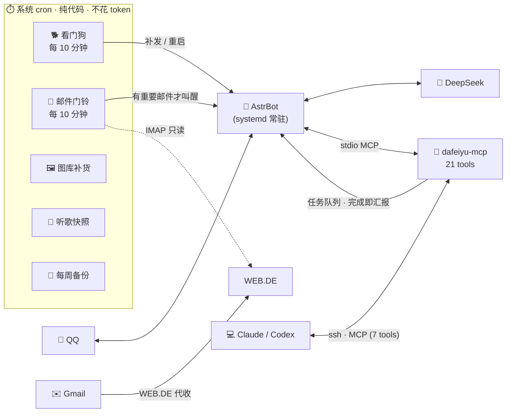

<div align="center">

# ☁️ Cloud Server · 云端服务器

**一台 2 核 2G 的云服务器，从零到一养出一个会自己干活、会自己修自己、还很省 token 的 AI 助手「大肥鱼」。**

*From a bare 2-vCPU cloud VM to a self-healing, low-token AI assistant that lives in QQ.*

<p>
  
  
  
  
  
</p>
<p>
  
  
  
  
  
</p>

</div>

---

## ✨ 它每天在做什么

| 时间（德国） | 大肥鱼主动推送到 QQ |
|---|---|
| 06:00 | 📊 **大肥鱼日报**：昨天聊了什么、几点最活跃（代码统计）+ AI 总结点评 |
| 06:05 | 🖥️ **服务器日报**：资源圆环、服务状态灯、过去 24 小时**每条推送是否真的送达** |
| 06:30 / 06:45 / 07:00 | 🎨 **今日画廊**：喜欢的角色高分图，一张张发、配点评 |
| 07:20 | ⏰ **叫床**：今天有什么课 + 天气（下雨提醒带伞） |
| 12:00 · 15:00 · 20:00 · 00:00 | 💬 午饭 / 下午 / 晚饭 / 晚安问候 |
| 23:05 | 🎵 **网易云品鉴**：今日推荐吻合度、风格地图、必听 5 首 |
| 随时 | 📬 **重要邮件**：Gmail 来了考试 / 账单 / 房租 / 学校通知才推，广告不打扰 |
| 随时 | 🤝 **电脑协作**：QQ 派活 → 电脑上的 Claude / Codex 领取完成 → QQ 汇报 |

## 🏗️ 架构



**四个角色：** AstrBot 是身体（收发消息、跑定时任务）· DeepSeek 是大脑 · **dafeiyu-mcp 是手**（AI 主动调用的工具箱）· **看门狗 + 邮件门铃是自主神经**（不用 AI 的后台程序，盯着、修着、有事才叫醒 AI）。

## 🧠 设计原则

| 原则 | 落地 |
|---|---|
| **能用代码做的，不让 AI 做** | 统计、计数、去重、送达检查、修复全是代码；AI 只负责“理解”和“说话” |
| **AI 是被叫醒的，不是轮询的** | 邮件门铃每 10 分钟用代码看一眼，有非广告新邮件才叫醒 AI；几千封旧邮件按日期过滤，AI 一封都看不到 |
| **自动修复要有刹车** | 推送没送达 → 补发 **1 次**；补发还失败就停手交给日报；重启 1 小时最多 1 次 |
| **监控程序自己也要被监控** | 看门狗写心跳，服务器日报检查它；门铃也有心跳。`flock` 防重叠、`timeout` 防卡死、`nice` 不抢 CPU |
| **测试不能动生产状态** | 会推进“已读位置”的函数都有只读版本；体检 / 验收 / 门铃一律只读 |
| **越轻越不容易坏** | 电脑端只加载 7 个工具（≈1K token / 新对话）；上下文上限 30 轮 |

## 📈 一些数字

| | |
|---|---|
| 看门狗每次运行 | **0.44 秒 · 33 MB**，跑完即退 |
| 重要邮件延迟 | Gmail → WEB.DE **≈2 分钟** → 门铃 ≤10 分钟 → QQ |
| 故障演练 | 故意不发的任务 → 7 分钟后自动补发 → 补发失败按规则放弃 ✅ |
| 电脑协作 | 任务完成后 **2 秒** QQ 收到汇报 |
| 验收 | `acceptance.sh` **26 通过 · 1 提醒 · 0 失败**（稳定 / 自动化 / 送达 / 自愈 / 邮件 / 数据 / 安全 / 成本） |
| 省钱 | 发现上下文无上限（每次推送从 2K 涨到 20K token）→ 限 30 轮；DeepSeek 缓存命中 87% |

## 📁 目录

```
cloud-server/
├── dafeiyu-mcp/          # 代码
│   ├── server.py         #   MCP 服务器：21 个工具，按身份（大肥鱼 / 电脑端）注册
│   ├── watchdog.py       #   看门狗：补发、重启、补货、清理（有刹车 + 心跳）
│   ├── mail_check.py     #   邮件门铃：只看不推进，有事才叫醒 AI
│   ├── ncm.py …          #   网易云接口、Pillow 画卡片、图库
│   ├── acceptance.sh     #   一键验收（只读，30 秒）
│   └── healthcheck.sh    #   体检 + 冒烟测试
├── deploy/               # systemd 服务、cron、备份脚本
└── docs/                 # 10 章中文文档（下表）
```

## 📚 文档

| 章节 | 内容 |
|---|---|
| [00 项目总览](docs/00-项目总览.md) | 架构、组件清单、推送时间表、踩过的坑 |
| [01 人格设定](docs/01-大肥鱼人格设定.md) | 大肥鱼的性格提示词 |
| [02 工具箱](docs/02-dafeiyu-mcp工具箱.md) | 21 个工具一览 |
| [03 运维手册](docs/03-运维手册.md) | 出问题时看这里 |
| [04 命令大全](docs/04-学习笔记-命令大全.md) | 从零到一学过的 Linux / 运维命令 |
| [05 MCP 开发详解](docs/05-MCP开发详解.md) | MCP 原理、stdio、怎么写一个新工具 |
| [06 改进记录与规则](docs/06-改进记录与规则.md) | 13 条规则 + 每次改进的现象 / 原因 / 修复 / 验证 |
| [07 测试与验收](docs/07-测试与验收.md) | 测试分层、所有用例、token 花在哪 |
| [08 看门狗与邮件门铃](docs/08-看门狗与邮件门铃开发详解.md) | 不用 AI 的后台程序怎么写 |
| [09 电脑协作](docs/09-电脑协作-Claude-Codex.md) | MCP over SSH、任务队列、工作原理 |

## 🚀 自己搭一个

1. 一台 Linux 服务器（2C2G 够用），`uv tool install astrbot`，在固定目录初始化，用 `deploy/astrbot.service` 托管
2. AstrBot 后台接模型（DeepSeek）、人格、QQ 官方机器人
3. 复制 `dafeiyu-mcp/`，`config.example.json` → `config.json`（权限 600），`register.sh` 注册进 AstrBot
4. 装 cron：`deploy/` 里的备份、图库、快照，加上看门狗和邮件门铃
5. `bash dafeiyu-mcp/acceptance.sh` 验收

> 🔒 密钥、登录态、邮箱密码只在服务器上（600），不进仓库；这个公开版已去掉 IP、邮箱、账号和个人课表。

## 🗺️ 路线

- [x] 买机器 · Linux · 安全 · Docker 入门 · 网络
- [x] 部署 AstrBot + 人格 + 定时推送
- [x] 手写 MCP 工具箱（日报 / 网易云 / 画廊 / 服务器状态 / 邮件）
- [x] 自愈看门狗 · 服务器日报送达检查 · 一键验收
- [x] 重要邮件（Gmail → WEB.DE → 门铃）
- [x] 电脑协作（MCP over SSH + 任务队列）
- [ ] pandas 听歌口味周报（数据每天在攒）
- [ ] Docker + Jupyter 云端数据分析

<div align="center"><sub>小さな一歩でも、毎日進む。· One small step at a time.</sub></div>
